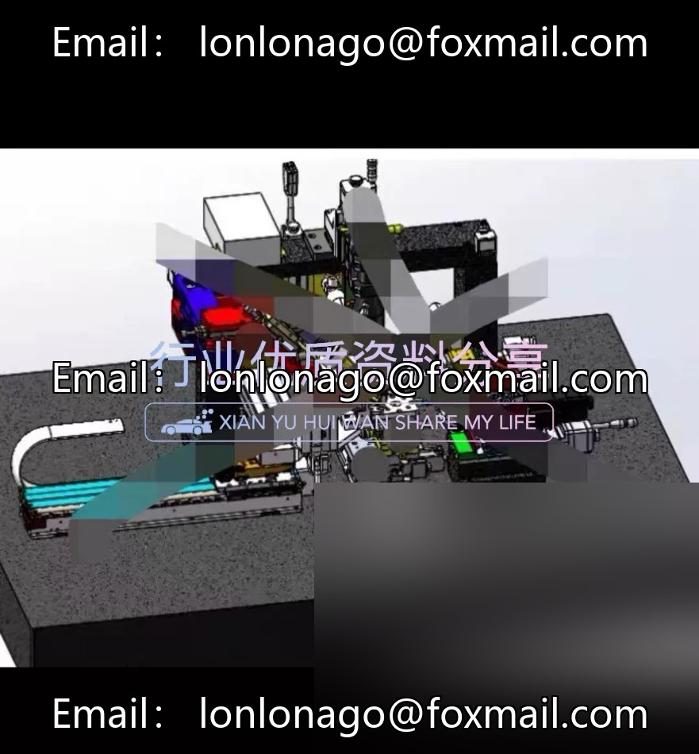

# Light module lens Lens coupling equipment detailed 3D drawings! Stp! Including marble working

## Body

Light module lens Coupling Equipment detailed 3D drawings! Stp! Including marble worktable, six-axis AA module, optical chip molding, cure module! Visual module! Power meter module, fixture module etc! Adopting high-precision design!

Capture and send the electronic original directly! The following images include screenshots of the file portion. Please confirm before placing the order! Due to the replicable nature of electronic documentation Therefore, are allowed after purchase! Thanks for understanding!

For personal learning and reference use only.

Detailed 3D drawings for optical module lens Coupling equipment are provided, including marble workstations, six-axis AA modules, optochip loading, dotting and curing modules, vision modules, power meter modules, tools and other components, with high-precision design.

<!-- AI_ENRICHED -->

## Images

## Payment

Here is a pay link on Stripe ( https://buy.stripe.com/3cs8yP7sY87d0vu9AB ). Please contact me lonlonago@foxmail.com after funding $89, and I will send you a complete data files , thank you!

